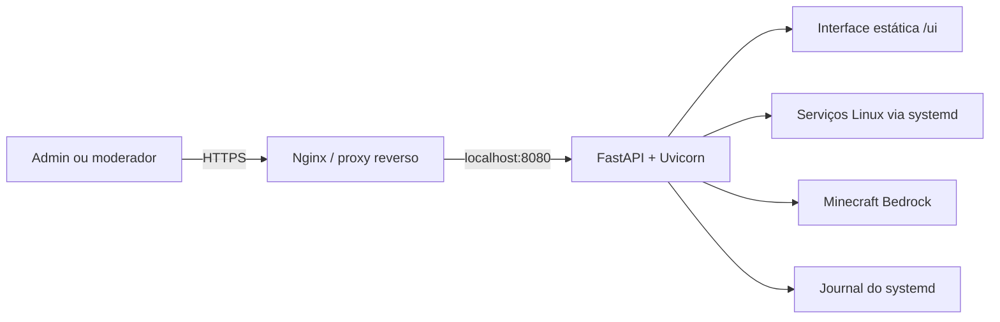

# MC Server Dashboard

> Um pequeno laboratório de administração de servidores: FastAPI, Linux, automação e Minecraft Bedrock em um painel web.

Este projeto nasceu para experimentar uma forma prática de operar uma VPS sem precisar entregar acesso SSH a todos os usuários. Ele reúne uma interface web simples e uma API para acompanhar o servidor Minecraft Bedrock e executar algumas tarefas administrativas com permissões controladas.

Mais do que um painel pronto, este repositório funciona como um **laboratório de aprendizado e experimentação**: um lugar para explorar integração com `systemd`, autenticação, controle de acesso, automação de deploy e operação de serviços em uma VM Linux pequena.

## O que dá para fazer

- Consultar o estado do Minecraft Bedrock e de serviços autorizados.
- Reiniciar o servidor de Minecraft.
- Consultar jogadores vistos recentemente nos logs e seus XUIDs.
- Consultar e atualizar a allowlist usando gamertag e XUID.
- Enviar comandos ao console do Minecraft por um FIFO já existente (somente admin).
- Administrar serviços e modos de operação em lote conforme as permissões configuradas.
- Acessar as funções por uma interface web em `/ui/` ou pela API REST.

Para encontrar um XUID fora dos logs, o formulário da interface também aponta para o [Xbox XUID Finder](https://www.cxkes.me/xbox/xuid); use o valor **Decimal**.

## Como funciona



A interface não precisa de uma etapa de build: é HTML, CSS e JavaScript estático servido pelo próprio FastAPI. A aplicação é iniciada por `main:app`; controladores HTTP ficam em `controllers/` e integrações com o sistema e com os jogadores ficam em `services/`.

## Tecnologias e ideias exploradas

- **Python + FastAPI** para a API e a documentação OpenAPI.
- **HTML/CSS/JavaScript sem framework** para manter o frontend leve.
- **systemd e journalctl** para operar e observar serviços Linux.
- **Autenticação HTTP Basic e RBAC** com perfis `admin` e `moderator`.
- **GitHub Actions via SSH** para deploy manual em uma VPS.
- Validação de entradas, lista permitida de ações/serviços e chamadas de subprocesso sem `shell=True`.

## Estrutura do projeto

```text
.
├── auth.py                 # Autenticação e autorização por perfil
├── controllers/            # Rotas HTTP da API
├── services/               # Integrações com systemd, Minecraft e jogadores
├── frontend/index.html     # Interface web estática
├── systemd/                # Exemplos de unidades systemd
├── tests/                  # Testes automatizados
├── users.example.json      # Modelo de configuração de usuários
├── documentacao.md         # Documentação operacional detalhada
└── .github/workflows/      # Deploy manual para a VPS
```

## Executar localmente

O painel foi pensado para Linux. Em Windows é possível inspecionar o código e executar partes da aplicação, mas funções que dependem de `systemd`, `sudo` e dos logs do Minecraft precisam de um ambiente Linux configurado para funcionar.

Com Python 3.10 ou superior:

```bash
python3 -m venv .venv
source .venv/bin/activate
pip install -r requirements.txt
cp users.example.json users.json
```

Edite `users.json`: defina senhas fortes e únicas e mantenha pelo menos um usuário com perfil `admin`. Esse arquivo contém credenciais e não deve ser commitado.

Inicie em modo de desenvolvimento:

```bash
uvicorn main:app --host 127.0.0.1 --port 8080 --reload
```

- Interface: <http://127.0.0.1:8080/ui/>
- Documentação interativa da API: <http://127.0.0.1:8080/docs>

As rotas autenticadas usam HTTP Basic. Em uma instalação real, proteja o acesso com HTTPS; não exponha Uvicorn diretamente à Internet.

### Testes

```bash
python -m unittest discover -s tests
```

## Configuração

| Variável | Finalidade | Padrão |
|---|---|---|
| `ENVIRONMENT` | Com o valor `production`, desativa `/docs`, `/redoc` e `/openapi.json`. | `development` |
| `USERS_FILE` | Caminho completo para o JSON de usuários e credenciais. | `users.json` ao lado de `main.py` |
| `MINECRAFT_DIR` | Diretório dos arquivos do Bedrock, incluindo `allowlist.json`. | `/home/ubuntu/minecraft` |
| `MINECRAFT_FIFO` | Caminho do FIFO já criado para encaminhar comandos ao console do Minecraft. | `/tmp/minecraft.fifo` |

Os serviços controláveis e as ações aceitas são definidos explicitamente no código. A conta que executa o dashboard precisa das permissões restritas correspondentes em `sudoers`; não conceda acesso irrestrito a comandos administrativos.

## Perfis de acesso

- **`admin`**: pode usar as funções administrativas, incluindo serviços e operações em lote permitidos, além das funções exclusivas de administração do Minecraft.
- **`moderator`**: pode usar as funções selecionadas do Minecraft, como consultar jogadores, ver a allowlist, adicionar jogadores e reiniciar o servidor, sem acesso às operações administrativas gerais.

A lista de usuários fica em `users.json`, fora do código-fonte. O modelo `users.example.json` tem segredos vazios intencionalmente: preencha-os antes de iniciar a aplicação.

## Deploy na VPS

Há exemplos de unidade `systemd` na pasta `systemd/` e um workflow manual em `.github/workflows/deploy-vps.yml`. O workflow atualiza a branch `main`, instala dependências e reinicia `server-dashboard.service`.

Para configurar os secrets do GitHub Actions, permissões, HTTPS, `sudoers` e os serviços da VPS, consulte o [guia operacional detalhado](documentacao.md). A implantação pressupõe que o repositório já esteja clonado na VPS, que exista um `.venv` no diretório do projeto e que o usuário SSH tenha as permissões mínimas necessárias.

## Escopo e segurança

Este é um projeto pessoal/laboratorial e não substitui uma revisão de segurança nem uma solução de gestão de infraestrutura. Antes de expor uma instalação:

1. Use HTTPS por meio de um proxy reverso e mantenha o Uvicorn ligado apenas a `127.0.0.1`.
2. Configure credenciais fortes e exclusivas e proteja `users.json`.
3. Revise as permissões de `sudoers` para liberar somente os comandos necessários.
4. Confirme os caminhos dos arquivos e serviços no seu próprio servidor.
5. Não publique chaves SSH, senhas ou outros secrets no repositório.

Consulte também a [documentação completa](documentacao.md) para detalhes de instalação, configuração e operação.
