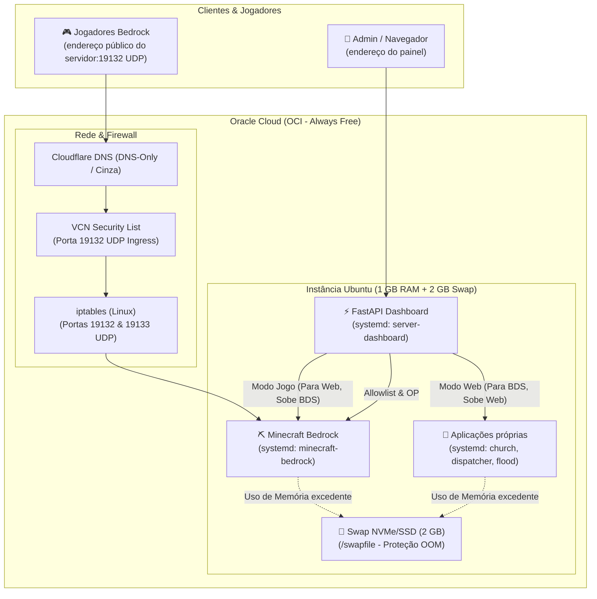

# 🎮 Guia de Infraestrutura: Servidor Minecraft Bedrock & Admin Dashboard

Documentação técnica completa da infraestrutura de alta eficiência hospedada na **Oracle Cloud Infrastructure (OCI Always Free)**, integrando o **Minecraft Bedrock Dedicated Server (BDS)** a um painel de controle leve em **FastAPI** com alternância de perfis (Modo Jogo vs Modo Web).

---

## 🏛️ 1. Arquitetura da Solução

O servidor opera em uma instância com recursos enxutos (1 GB de RAM física). O FastAPI atua como camada de orquestração local via `systemd` e arquivos de configuração, permitindo gerenciar o ciclo de vida dos serviços e os jogadores diretamente pelo navegador, sem necessidade constante de acesso SSH.



---

## ⚙️ 2. Especificações da Máquina & Sistema

- **Provedor:** Oracle Cloud Infrastructure (OCI) — Always Free
- **Processador / Arquitetura:** AMD/x86_64 (`VM.Standard.E2.1.Micro` / `vnic-micro-genesis`)
- **Sistema Operacional:** Ubuntu 22.04 / 24.04 LTS
- **Memória RAM:** 1 GB Física (~956 MiB utilizáveis)
- **Memória Virtual (Swap):** 2 GB (em SSD/NVMe)
- **Domínio do Minecraft:** `mc.endereco.br` (Porta UDP `19132`)
- **Dashboard Admin:** `https://dash.endereco.com.br/ui/` (interface web)

---

## 💾 3. Configuração de Memória Swap (2 GB)

Em ambientes com 1 GB de RAM física, o executável do Minecraft ou picos nas aplicações podem acionar o *OOM Killer* do Linux. O Swap atua como rede de proteção contra congelamentos:

```bash
# 1. Alocar 2 GB de espaço em disco
sudo fallocate -l 2G /swapfile

# 2. Definir permissões de segurança estritas
sudo chmod 600 /swapfile

# 3. Formatar e ativar o espaço de Swap
sudo mkswap /swapfile
sudo swapon /swapfile

# 4. Tornar a ativação persistente no boot
echo '/swapfile none swap sw 0 0' | sudo tee -a /etc/fstab

# 5. Validar ativação
free -h
```

---

## 🌐 4. Rede, Firewall & Cloudflare DNS

### A. Regra no Painel da Oracle Cloud (VCN Security List)
No console OCI (**Networking > Virtual Cloud Networks > [Sua VCN] > Security Lists > Default Security List**):
- **Source Type:** CIDR
- **Source CIDR:** `0.0.0.0/0`
- **IP Protocol:** `UDP`
- **Destination Port Range:** `19132`

### B. Firewall Interno do Linux (`iptables`)
O Ubuntu na Oracle traz regras restritivas por padrão. Execute para liberar o tráfego UDP de entrada:

```bash
# Inserir no topo da cadeia INPUT para porta principal e IPv6 fallback
sudo iptables -I INPUT 1 -p udp --dport 19132 -j ACCEPT
sudo iptables -I INPUT 1 -p udp --dport 19133 -j ACCEPT

# Salvar as regras de forma persistente
sudo netfilter-persistent save

# Conferir regras e contagem de pacotes
sudo iptables -L INPUT -n -v --line-numbers
```

### C. Apontamento no Cloudflare
- **Tipo:** `A`
- **Nome:** `mc` (use o domínio configurado no seu provedor DNS)
- **IPv4 address:** `<IP_PUBLICO_DA_VM>`
- **Proxy status:** **DNS only (Nuvem Cinza)**
  > [!WARNING]
  > **Atenção:** O Proxy Laranja do Cloudflare é exclusivo para tráfego HTTP/HTTPS e bloqueia conexões UDP diretas do Minecraft Bedrock. Mantenha em **DNS only**.

---

## ⛏️ 5. Servidor Minecraft Bedrock Dedicated Server (BDS)

### A. Download Oficial (Evitando Bloqueios)
O executável oficial exige cabeçalho de navegador para download:

```bash
mkdir -p ~/minecraft && cd ~/minecraft
curl -H "User-Agent: Mozilla/5.0" -L -o bedrock-server.zip "https://www.minecraft.net/bedrockdedicatedserver/bin-linux/bedrock-server-1.26.52.3.zip"
unzip bedrock-server.zip
chmod +x bedrock_server
```

### B. Otimização do `server.properties`
Configurações otimizadas para baixo consumo de RAM e transporte direto via **RakNet**:

```properties
server-name=Servidor Bedrock
gamemode=survival
difficulty=easy
allow-cheats=false
max-players=4
online-mode=true
allow-list=false

# Otimizações de Memória
view-distance=6
tick-distance=4
max-threads=2

# Protocolo e Portas (RakNet)
transport=raknet
server-port=19132
server-portv6=19133
server-ip=0.0.0.0
```

> [!NOTE]
> **RakNet vs NetherNet:** O protocolo novo `transport=nethernet` realiza handshake inicial via HTTP TCP na porta 19132. Para conexões diretas por IP/UDP sem precisar abrir portas TCP extras na OCI, o modo padrão `transport=raknet` é o mais estável e recomendado.

### C. Serviço Systemd (`minecraft-bedrock.service`)

Crie o arquivo `/etc/systemd/system/minecraft-bedrock.service`:

```ini
[Unit]
Description=Minecraft Bedrock Dedicated Server
After=network.target

[Service]
User=ubuntu
WorkingDirectory=/home/ubuntu/minecraft
ExecStart=/bin/sh -c "LD_LIBRARY_PATH=. ./bedrock_server"
Restart=always

[Install]
WantedBy=multi-user.target
```

Ative e inicie:
```bash
sudo systemctl daemon-reload
sudo systemctl enable --now minecraft-bedrock
sudo systemctl status minecraft-bedrock
```

---

## ⚡ 6. Dashboard Admin com FastAPI & Segurança Reforçada

Painel de controle local que expõe endpoints REST para gerenciar a VM. A interface operacional fica em `/ui/`; Swagger UI está disponível em `/docs` apenas fora de produção.

### Organização do código
O ponto de entrada continua sendo `main:app`. A interface estática em `frontend/index.html` é servida em `/ui/` e consome as rotas HTTP; não há framework nem etapa de build. As rotas estão separadas por contexto em `controllers/auth.py`, `controllers/system.py` e `controllers/minecraft.py`. `auth.py` concentra identidade e permissões; `services/system.py` e `services/minecraft.py` reúnem a lógica e as integrações de serviços (systemd e FIFO do Minecraft).

O painel solicita usuário e senha e mantém a credencial HTTP Basic somente em memória enquanto a página estiver aberta; não usa `localStorage` nem cookies próprios. HTTPS continua obrigatório. Em produção, desative Swagger, ReDoc e OpenAPI definindo `ENVIRONMENT=production` na seção `[Service]` do systemd:

```ini
Environment=ENVIRONMENT=production
```

Depois aplique a mudança com `sudo systemctl daemon-reload` e reinicie o serviço do dashboard. Em qualquer outro valor de `ENVIRONMENT` (ou se a variável não estiver definida), a documentação interativa permanece habilitada para desenvolvimento.

O virtual host de exemplo em `nginx/mc-server-dashboard` redireciona HTTP para HTTPS e termina TLS no Nginx; ele espera um certificado Let's Encrypt em `/etc/letsencrypt/live/MEU_DOMINIO/`. Antes de instalá-lo, substitua `MEU_DOMINIO` pelo domínio real e emita o certificado com Certbot, usando a configuração HTTP atual e `sudo certbot --nginx -d <seu-dominio>`. Depois instale o virtual host atualizado e valide/recarregue o Nginx:

```bash
sudo nginx -t
sudo systemctl reload nginx
sudo certbot renew --dry-run
```

Mantenha o Uvicorn vinculado a `127.0.0.1` e não exponha a porta `8080` publicamente. Se usar Cloudflare, configure SSL/TLS como **Full (strict)** para manter criptografia também entre o proxy e o Nginx.

### A. Camada de Segurança & RBAC (Role-Based Access Control)
Para prevenir riscos ao executar comandos de sistema (`systemctl`), a API conta com:
1. **Autenticação HTTP Basic**:
   - A interface `/ui/` solicita usuário e senha; os endpoints também exigem autenticação diretamente.
   - Comparação segura com `secrets.compare_digest` para evitar vazamento por análise de tempo (*timing attacks*).
2. **Perfis de Acesso (RBAC)**:
   - **`admin`**: Acesso irrestrito a todos os endpoints, incluindo perfis em lote (`gaming-mode`, `web-mode`, `stop-all`), serviços web e promoção a Operador (`/op/add`).
   - **`moderator` (Amigos)**: Acesso restrito exclusivamente ao ecossistema do Minecraft:
     - ✅ Reiniciar o servidor (`/minecraft/restart`)
     - ✅ Adicionar novos amigos na allowlist (`/minecraft/allowlist/add`)
     - ✅ Visualizar status de execução do jogo (`/system/status`)
     - ❌ **Bloqueado** para parar/iniciar as aplicações próprias, modos em lote ou dar OP.
3. **Prevenção Total de Command Injection**:
   - `shell=True` foi completamente **eliminado**.
   - Os comandos são disparados em vetor estrito de argumentos (`["sudo", "systemctl", action, service]`).
   - Whitelist estrita de serviços (`ALLOWED_SERVICES`) e ações (`ALLOWED_ACTIONS`).

### B. Gestão de Credenciais (`users.json`)
As credenciais não possuem valores padrão no código. Copie o modelo, defina senhas fortes e únicas para cada usuário e restrinja o arquivo ao usuário `ubuntu`:

```bash
cd ~/server-dashboard
cp users.example.json users.json
nano users.json
chmod 600 ~/server-dashboard/users.json
```

O dashboard lê `users.json` ao lado de `main.py` por padrão. Para armazená-lo em outro local, defina `USERS_FILE` no ambiente do serviço systemd com o caminho completo. Se o arquivo estiver ausente, inválido ou inacessível, as rotas autenticadas respondem com erro de configuração (503); não existe fallback com credenciais embutidas.

#### Comandos no console do Minecraft
O endpoint `POST /minecraft/command` aceita um único comando por requisição (parâmetro `command`) e é exclusivo para administradores. Ele escreve diretamente em um FIFO já existente, sem executar shell. Por padrão, o caminho é `/tmp/minecraft.fifo`; configure `MINECRAFT_FIFO` no ambiente do dashboard para usar outro caminho.

O FIFO precisa ser criado com acesso restrito e conectado a um leitor que encaminhe a entrada ao console do Bedrock. O endpoint não cria o canal nem inicia esse leitor; se o FIFO não existir ou não houver leitor ativo, retorna erro `503`. Os comandos são limitados a 256 caracteres e não aceitam quebras de linha ou caracteres nulos.

### C. Permissões Restritas no `sudoers` (Mínimo Privilégio)
Em vez de liberar comandos arbitrários com `*`, limite o `sudoers` aos serviços próprios e ao Minecraft. O serviço `redis.service` é um link para o Redis do sistema e não é controlado pelo dashboard; serviços da Oracle/Linux também ficam fora da whitelist.

```bash
sudo bash -c 'echo "ubuntu ALL=(ALL) NOPASSWD: /bin/systemctl start minecraft-bedrock, /bin/systemctl stop minecraft-bedrock, /bin/systemctl restart minecraft-bedrock, /bin/systemctl is-active minecraft-bedrock, /bin/systemctl start church, /bin/systemctl stop church, /bin/systemctl restart church, /bin/systemctl is-active church, /bin/systemctl start dispatcher, /bin/systemctl stop dispatcher, /bin/systemctl restart dispatcher, /bin/systemctl is-active dispatcher, /bin/systemctl start flood, /bin/systemctl stop flood, /bin/systemctl restart flood, /bin/systemctl is-active flood, /usr/bin/journalctl -u minecraft-bedrock --no-pager -n 2000 -o cat" > /etc/sudoers.d/dashboard-mc'
sudo visudo -cf /etc/sudoers.d/dashboard-mc
```

### D. Tabela de Endpoints e Níveis de Permissão

| Método | Endpoint | Perfil Mínimo | Descrição |
| :--- | :--- | :--- | :--- |
| **GET** | `/auth/me` | Qualquer autenticado | Exibe dados do usuário logado e sua role. |
| **GET** | `/system/status` | Moderator / Admin | Status do Minecraft (Moderator) ou telemetria completa (Admin). |
| **POST** | `/minecraft/restart` | **Moderator / Admin** | Reinicia o servidor de Minecraft com segurança. |
| **GET** | `/minecraft/players/recent` | **Moderator / Admin** | Busca jogadores conectados recentemente nos últimos 2.000 registros do journal do Minecraft e retorna gamertag e XUID. |
| **GET** | `/minecraft/allowlist` | **Moderator / Admin** | Lista jogadores aceitos, incluindo XUID quando cadastrado. |
| **POST** | `/minecraft/allowlist/add`| **Moderator / Admin** | Adiciona/atualiza nome e XUID no `allowlist.json` e reinicia o BDS. |
| **POST** | `/minecraft/command` | **Admin Only** | Envia um comando ao console por FIFO. Requer leitor ativo. |
| **POST** | `/minecraft/op/add` | **Admin Only** | Concede permissão de Operador no `permissions.json` via XUID. |
| **POST** | `/service/{service}/{action}` | **Admin Only** | Executa `start`, `stop`, `restart` ou `status` em qualquer serviço da whitelist. |
| **POST** | `/batch/gaming-mode` | **Admin Only** | **Modo Jogo:** Para `church`, `dispatcher` e `flood`, e inicia o Minecraft. |
| **POST** | `/batch/web-mode` | **Admin Only** | **Modo Web:** Para o Minecraft e inicia `church`, `dispatcher` e `flood`. |
| **POST** | `/batch/stop-all` | **Admin Only** | Encerra todos os serviços registrados (manutenção). |

O endpoint de jogadores recentes precisa de permissão restrita para consultar o journal. O exemplo de `sudoers` acima libera somente a consulta dos últimos 2.000 registros do serviço `minecraft-bedrock`; confirme o caminho do `journalctl` com `command -v journalctl` no servidor e ajuste `/usr/bin/journalctl` se necessário. Jogadores encontrados nos logs podem ser adicionados à allowlist com nome e XUID; entradas antigas sem XUID continuam listadas e podem ser atualizadas quando a identidade for confirmada.

---

## 🛠️ 7. Guia Rápido de Operação & Diagnóstico

```bash
# Monitorar logs do Minecraft em tempo real
sudo journalctl -u minecraft-bedrock -f

# Monitorar logs do Dashboard FastAPI em tempo real
sudo journalctl -u server-dashboard -f

# Verificar tráfego de entrada UDP no firewall
sudo iptables -L INPUT -n -v | grep 19132

# Verificar uso de memória e Swap
free -h

# Reiniciar manualmente o Minecraft Bedrock
sudo systemctl restart minecraft-bedrock
```
